# Non-Slop

**Remove the defaults nobody chose. Keep the choices somebody made.**

Non-Slop is Non Arkaraprasertkul's rules against AI design slop, a zero-dependency linter, and four skills. It gives an agent a contract, a scanner, and a review that a different agent has to do. One install covers Claude Code, Codex, Cursor, Copilot, Windsurf, Gemini, and anything else that reads an `AGENTS.md`.

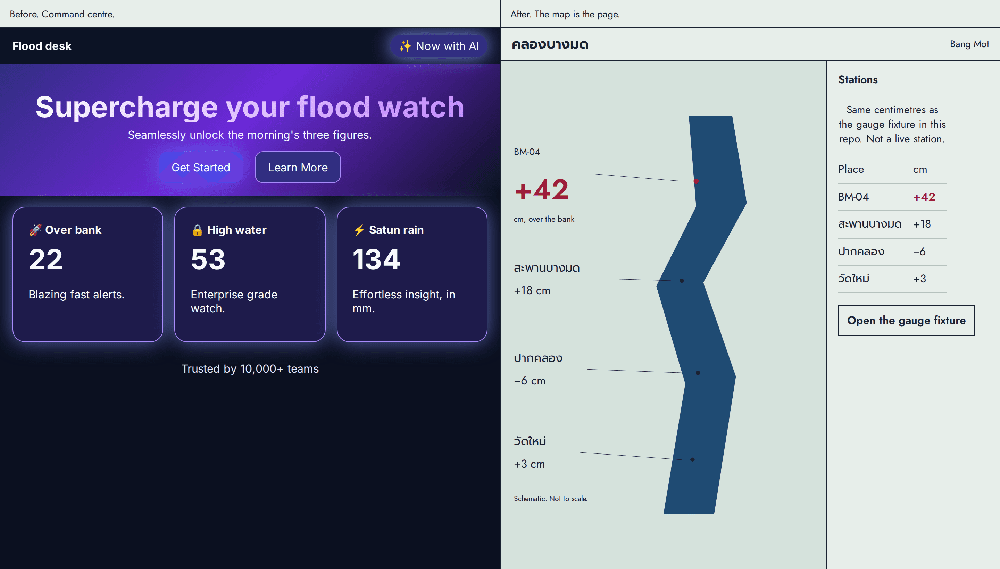

*Left: a dark command centre for the FloodDash press brief of 19 Oct 2026. Right: the Bang Mot canal board, where the map is the page. These are two HTML files in `examples/`, not one screen retouched. Playwright took the picture.*

It also protects your style. A generic "anti-AI" pass will happily delete your serif, your warm paper, your em dashes and your jokes, because AI uses them too. Here, your `STYLE.md` wins over every rule, and the scanner reports your choices as **ALLOWED** instead of failing them.

On 18 Oct 2026, 46 citizen flood apps were listed on FloodDash. 37 could be opened. 31 were labelled. A clean app had a median of **9 boxes** on a screen. A slop app had **45**. **68%** of the slop apps had 8 or more shadows. No clean app did. The linter caught 91% of that slop with 95% precision at the REVIEW line. Those two rates are in-sample and optimistic.

## Quick start

From the repo you want to protect:

```bash
curl -fsSL https://raw.githubusercontent.com/Nonarkara/Non-Slop/main/install.sh | sh
```

Same result, if you prefer npx:

```bash
npx -y github:Nonarkara/Non-Slop init
```

Or a submodule:

```bash
git submodule add https://github.com/Nonarkara/Non-Slop .non-slop && node .non-slop/bin/non-slop.mjs init
```

That writes `.non-slop/` (the rules, the skills, the scanner) and one pointer per tool. Missing files are created. If you already have `AGENTS.md`, `CLAUDE.md`, `GEMINI.md` or `copilot-instructions.md`, a short marked block is appended once. Your text is not changed. An existing `.cursor/rules/non-slop.mdc` or `.windsurf/rules/non-slop.md` is left as you wrote it. `init --update` only rewrites `.non-slop/`. Needs Node 18 or newer. The scanner has no dependencies.

| Tool | What it reads |
|---|---|
| Claude Code | `CLAUDE.md`. Optional PostToolUse hook, under The scanner. |
| Codex | `AGENTS.md`. No separate file. |
| Cursor | `.cursor/rules/non-slop.mdc` |
| Copilot | `.github/copilot-instructions.md` |
| Windsurf | `.windsurf/rules/non-slop.md` |
| Gemini | `GEMINI.md` |
| Any agent | `AGENTS.md` |

Check the source, from this repo or from `.non-slop` after install:

```bash
node bin/non-slop.mjs scan .
node .non-slop/bin/non-slop.mjs scan .
```

Check a rendered page. This needs Playwright (`npm i -D playwright && npx playwright install chromium`):

```bash
node bin/non-slop.mjs render http://localhost:3000
```

`slop-lint` is not in this repo. It lives in [Nonarkara/palette](https://github.com/Nonarkara/palette) (and in dr-non-vibecoding-skills). Same rendered thresholds: **6 or more is SLOP, 3 to 5 is REVIEW, under 3 is OK.**

```bash
npm i -D playwright pngjs && npx playwright install chromium
node tools/slop-lint.mjs http://localhost:3000
```

This repo's **scan** uses a different scale: SLOP at 8 or more points, REVIEW at 3 to 7. Do not mix the two numbers. Scan judges the source, including fonts. Render judges the pixels.

Paste this to any agent, once per repo:

> Install Non-Slop in this repo (`curl -fsSL https://raw.githubusercontent.com/Nonarkara/Non-Slop/main/install.sh | sh`), fill in STYLE.md with what's deliberate here, then read `.non-slop/AGENTS.md` and follow it for every UI change. STYLE.md wins over its rules. A different agent reviews before merge.

No install allowed? This works too: *"Before any UI work, read and follow https://github.com/Nonarkara/Non-Slop/blob/main/AGENTS.md."*

## Five patterns

Each pair is one tell and the fix. The HTML is in `examples/`. Static points are this repo's scan (SLOP at 8 or more). Render points use the palette weights (SLOP at 6 or more). Measured 19 Oct 2026.

### Padded cards, then a ruled strip

| Before | After |
|---|---|
| 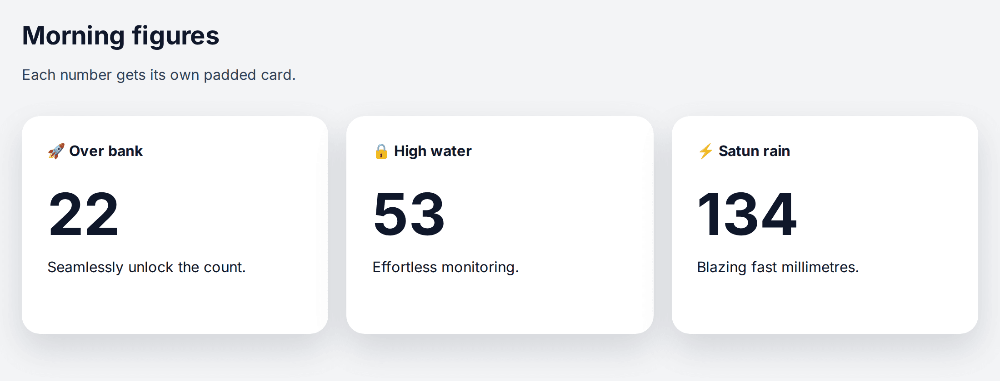 | 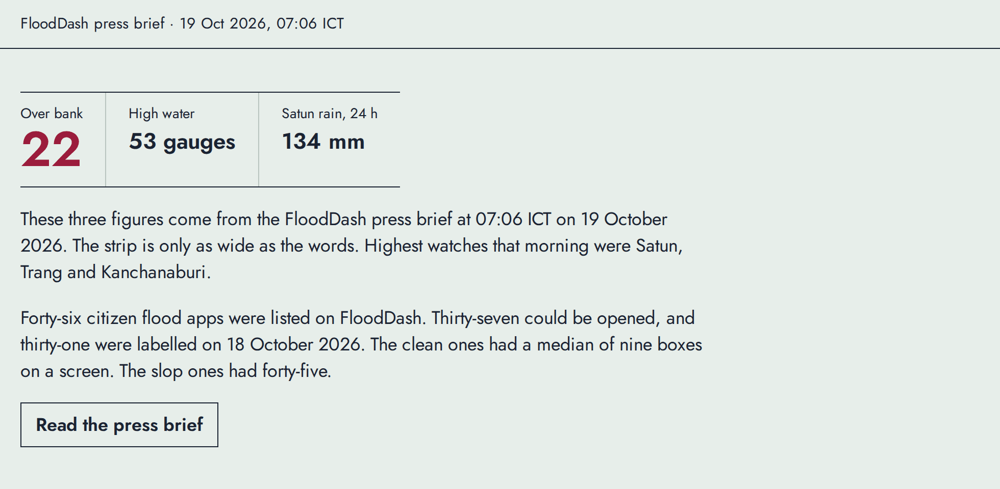 |

Static: before **SLOP 9**, after **OK 0**. Render: before **REVIEW 5**, after **OK 0**. The three big numbers are the pattern, so render still marks them.

### A dark command centre, then one sentence

| Before | After |
|---|---|
| 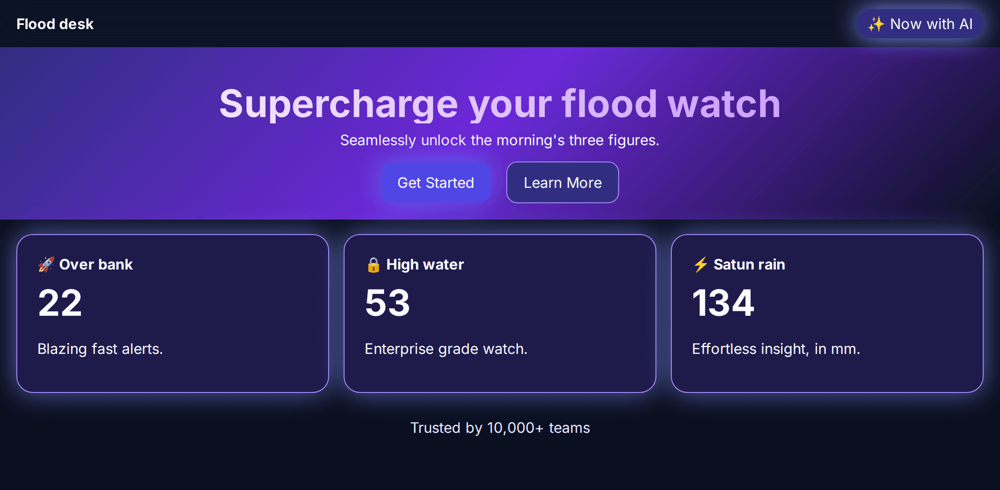 | 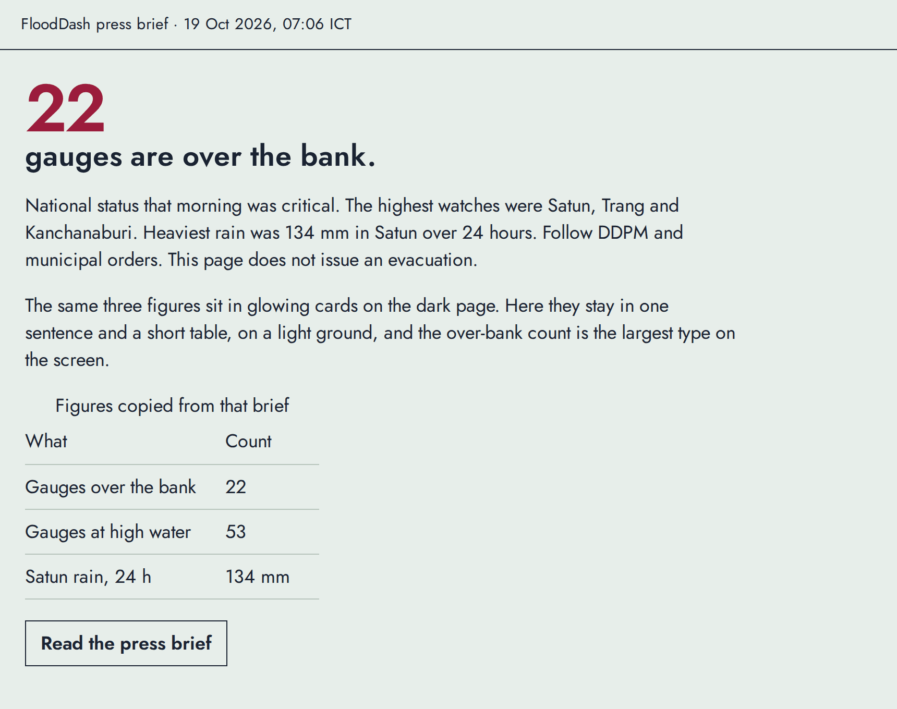 |

Static: before **SLOP 27**, after **OK 0**. Render: before **SLOP 10**, after **OK 0**.

### Inter, then Jost and Prompt

| Before | After |
|---|---|
| 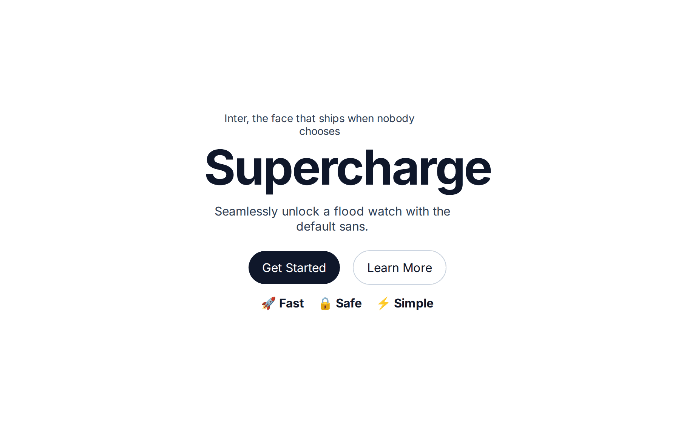 | 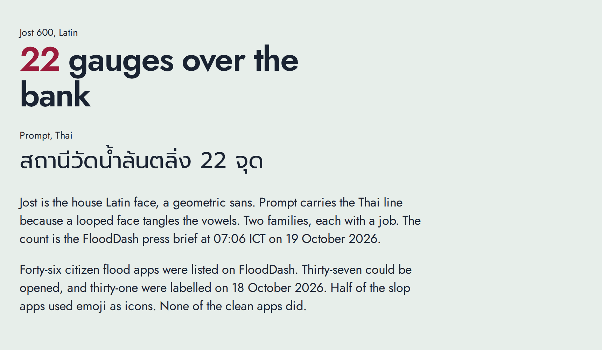 |

Static: before **SLOP 8**, after **OK 0**. Render: before **REVIEW 5**, after **OK 0**. Render gives the font a weight of 0. The static scan is what catches Inter.

### Everything centred, then the count on the left

| Before | After |
|---|---|
| 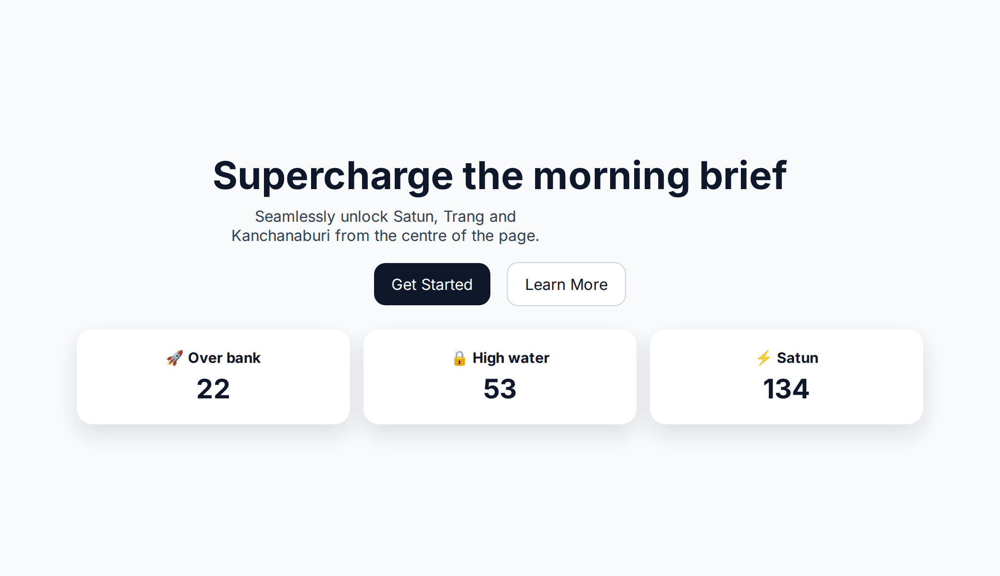 | 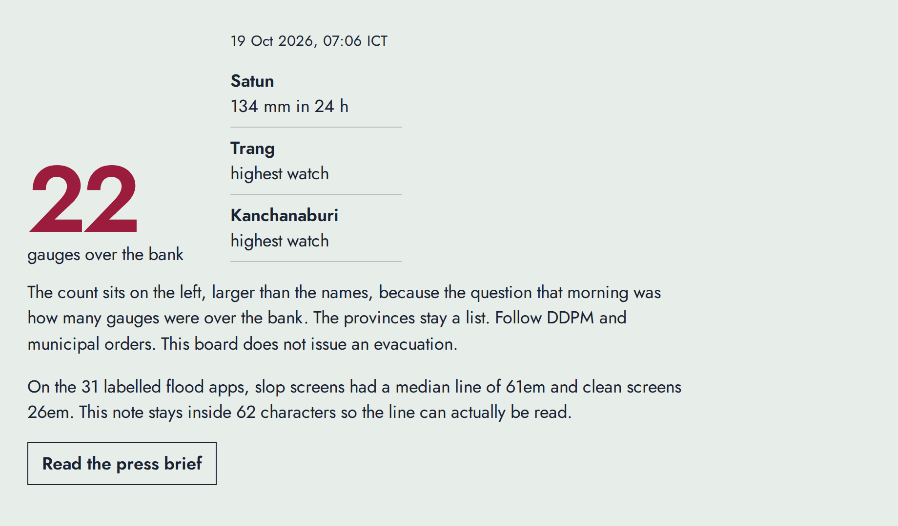 |

Static: before **SLOP 12**, after **OK 0**. Render: before **SLOP 10**, after **OK 0**.

### A pinhole map, then the surgical table

| Before | After |
|---|---|
| 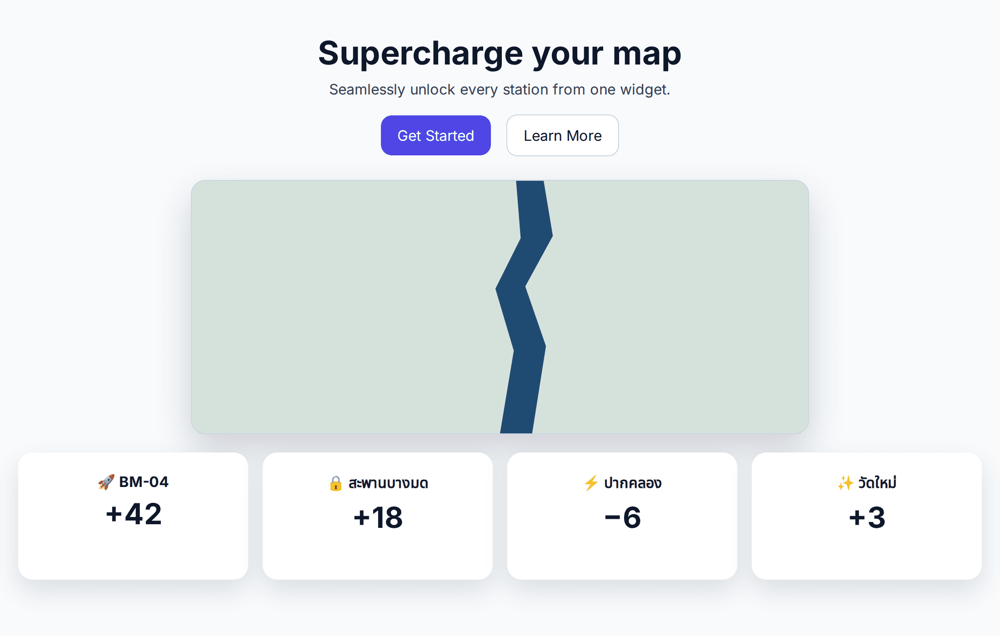 | 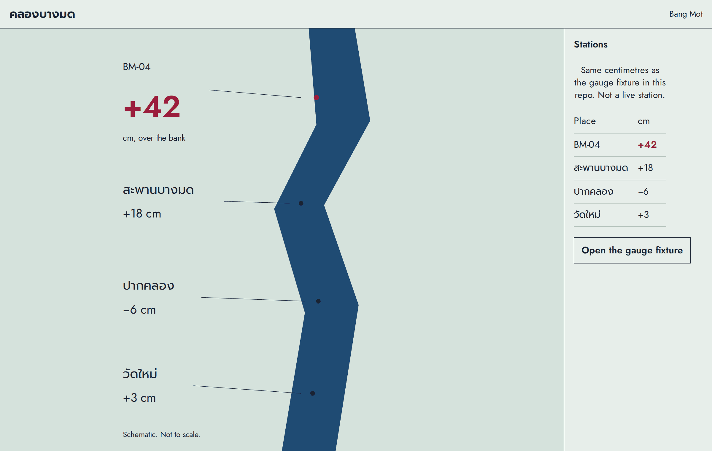 |

Static: before **SLOP 14**, after **OK 0**. Render: before **SLOP 9** (the map was 18% of the first screen), after **OK 0** (the map was 78%).

The hero frame and the study chart both scored **OK 0** on scan and on render.

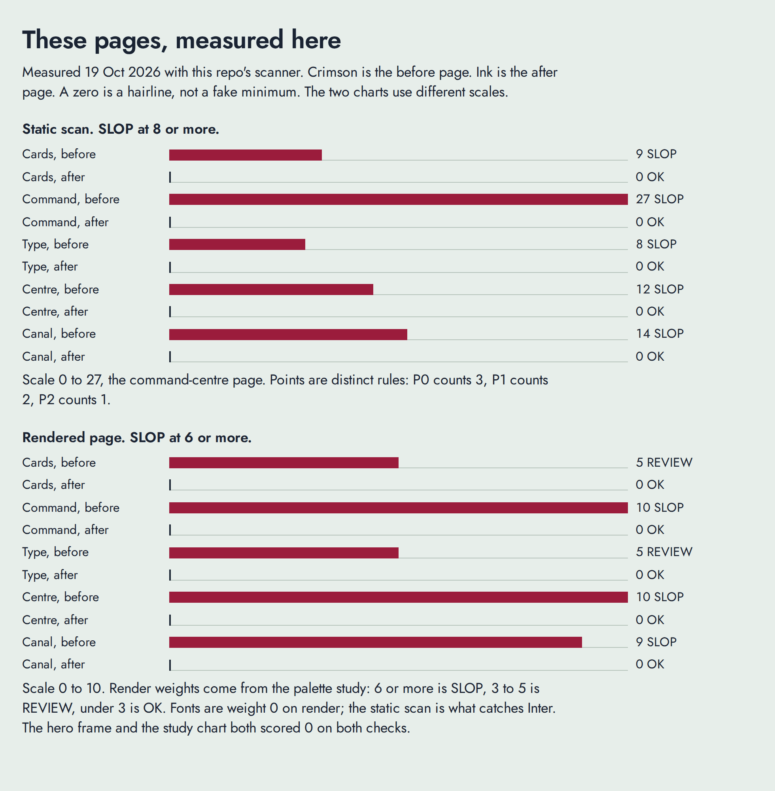

## How it runs

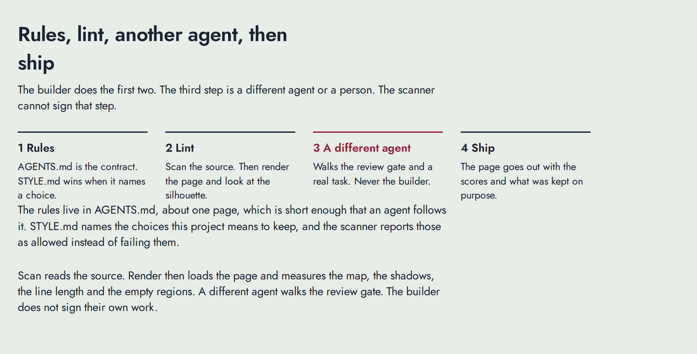

The same sequence, as mermaid:

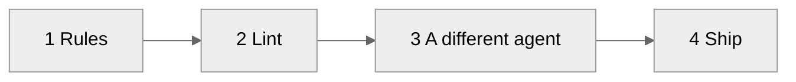

1. **Before coding:** a five-line brief (who, one job, what wins first, constraints, a direction taken from the subject's own world). Presets for civic dashboards, with the operational, map-first one as the default. → `skills/direction/`
2. **While coding:** tokens first, then subtract. Empty space is a decision; small things don't grow to fill it. On the words: quote a weak sentence and propose the smallest change that helps the reader; keep the voice. → `skills/writing/`
3. **After coding:** scan, render, look at the screenshots and the silhouette. → `skills/detect/`
4. **Before merge:** a different agent or person runs the review gate (task, access, states, languages, map rule, small interactions) and a real-task trial the scanner cannot judge, and lists what was kept on purpose. → `skills/review/`

The whole contract is [AGENTS.md](AGENTS.md), about one page, short enough that agents actually follow it. The long catalog lives in the skills.

## Where it plugs in

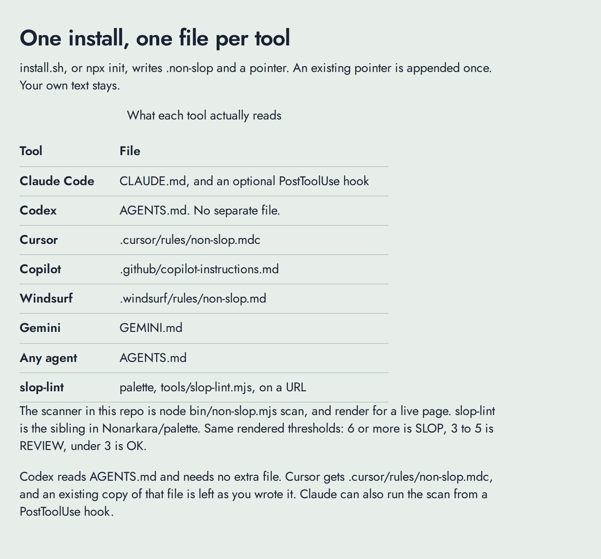

## What the study measured

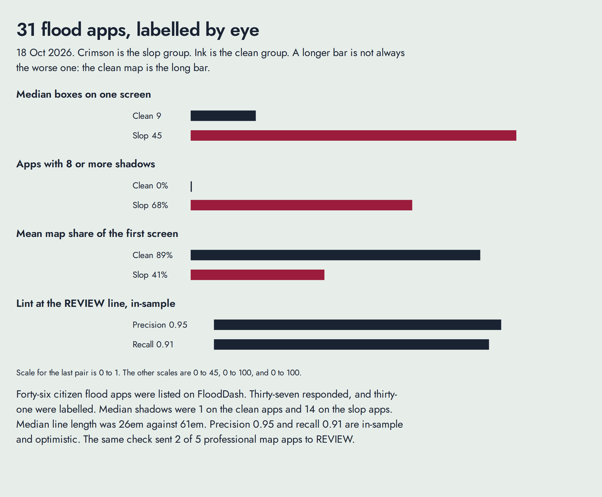

Figures from [palette ANTI-SLOP.md](https://github.com/Nonarkara/palette/blob/main/ANTI-SLOP.md), measured 18 Oct 2026. "Clean" is the median clean app. "Slop" is the median slop or mixed app. This table adds nothing that file does not already say.

| Measure | Clean | Slop |
|---|---|---|
| Median boxes on one screen | 9 | 45 |
| Apps with 8 or more shadows | 0% | 68% (median shadows 1 vs 14, up to 176) |
| Median line length | 26em | 61em (64% of slop over 40em) |
| Corner radii, and share of boxes rounded | 1 radius, 33% | 5 radii, 93% |
| Apps with 9 or more type sizes | not given | 55% (one had 22) |
| Emoji used as icons | 0% | 50% (up to 52) |
| Apps with 10 or more pills | not given | 45% (one had 53) |
| Dark command centre | 0% | 36%. Every clean app was light. |
| Stretch-to-fill | not given | 36% |
| Modal on first load | not given | 27% |
| Gradients or glass | not given | 27% |
| Mean map share of the first screen | 89% | 41% |
| Lint at the REVIEW line | precision 0.95, recall 0.91, in-sample | |

The same check sent 2 of 5 professional map apps to REVIEW. It misses a centred phone column that has a full-width header. After the linter, still look at the page.

## The scanner

```bash
node .non-slop/bin/non-slop.mjs scan .                       # your source
node .non-slop/bin/non-slop.mjs scan https://your-site.org   # a live page's HTML + CSS
node .non-slop/bin/non-slop.mjs render http://localhost:3000 # the rendered page (needs Playwright)
node .non-slop/bin/non-slop.mjs rules                        # every rule
```

(Without installing: `npx -y github:Nonarkara/Non-Slop scan .`)

- **scan** finds what's certain from source: 45 rules for fonts, colour, depth, layout, motion, icons, copy, imagery, accessibility and languages (EN/TH/ZH). Each hit has a severity (P0 anyone notices, P1 a designer notices, P2 polish), a fix, and when it's fine to keep. It judges the stack, not the item: one hit is a question; a stack is SLOP. An empty promise (`generic-promise`) is listed as **REVIEW**: it quotes the sentence, adds no points, and does not rewrite it.
- **render** loads the page at 1440, 1024 and 390 (plus a 320px reflow check), saves screenshots and a black-and-white **silhouette**, and measures stretch-to-fill, void, map share, bars, shadows, radii, pills, contrast, tap targets and keyboard focus. Install Playwright once with `npm i -D playwright && npx playwright install chromium`.
- `--json` for tools, `--fail-on=P0|P1|slop|never` for gates, `--staged` for hooks. Files bigger than 8 MB, and binary files, are listed and not scored. Symlinks are followed; a link that resolves to `/`, `/proc`, `/sys`, `/dev`, or `/run` is named and not walked, including when that link is the path you scanned. `init` does not write through a symlink, or to a path that resolves outside the project (the hook included).

It is a screen, not a judge. Render it, look at it, and get a second reviewer.

**In Claude Code**, check every edit as it happens. Add to `.claude/settings.json`:

```json
{ "hooks": { "PostToolUse": [ { "matcher": "Edit|Write|MultiEdit", "hooks": [ { "type": "command", "command": "node .non-slop/bin/non-slop.mjs scan --hook" } ] } ] } }
```

**In CI:** public repos can copy `templates/non-slop.yml` to `.github/workflows/`. Private repos should rely on the pre-commit hook.

## Protect your own style

Fill in `STYLE.md`. The prose sections tell agents what's deliberate (type, colour, devices, layout, voice). `## Protected voice` lists phrases and markers the scanner must not flag (a historical line, a quotation, an unusual metaphor, the story of the project). The `## Allow` section tells the scanner:

```markdown
## Allow
- rule cream-terracotta: warm paper and brick red are the house colours
- rule void: essay pages are a single reading column; the margins are the point
- rule emoji-icons in src/kids/**: playful register for children
- font "Source Serif 4": display face, chosen
- colour #fbf7ef: warm paper
- phrase "unlock a vibrant world of colour": the poster line, kept on purpose
```

```markdown
## Protected voice
- phrase "the water came up the soi at four": opening of the field note
- marker "Sanzo Wada": this page is about his colour book
```

Or inline, in code: `/* non-slop-allow: glass -- legibility over live video */`.

A sentence that contains a listed phrase, or a Protected voice phrase or marker, is not flagged. A listed phrase does not hide a different sentence, and a marker does not hide the other sentences on its line. Listing the rule `generic-promise` still reports it as **ALLOWED**, and it is not scored.

Allowed hits show as **ALLOWED** and cost nothing. A `## Signature` section in `AGENTS.md` is read the same way, including when `STYLE.md` exists but its Allow section is still empty. A `STYLE.md` in a subfolder covers the files under it, and allows from parent folders still apply. `Style.md` and `STYLE.md` are the same file. Accessibility rules (contrast, focus, alt text, unnamed controls, lang, zoom, reduced motion) can't be allowed away: they show as **ASK-OWNER**, so the agent raises them with you instead of quietly changing your design. Before removing anything, the agent asks: *would removing this make the page more generic? Then keep it.*

## Credits

Built from Non Arkaraprasertkul's own anti-slop rules, Palette's slop-lint and a measured study of 31 citizen-built flood apps, plus ideas from funboy322/avoid-ai-design, Vanszs/Anti-AI-UI, Anthropic's frontend-design skill, Microsoft's frontend-design-review skill, kari-ai-lab's design principles, Ruttl's web-design practices, Peter Yang's no-ai-slop review workflow and Jakub Krehel's interface-detail checks. The writing principle comes from Rakesh Mahanti's Instagram carousel, credited as a link only. Details and licences: [CREDITS.md](CREDITS.md). MIT licence.
